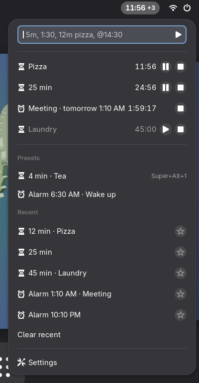
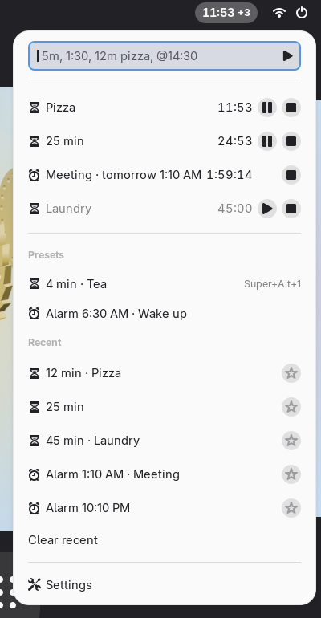
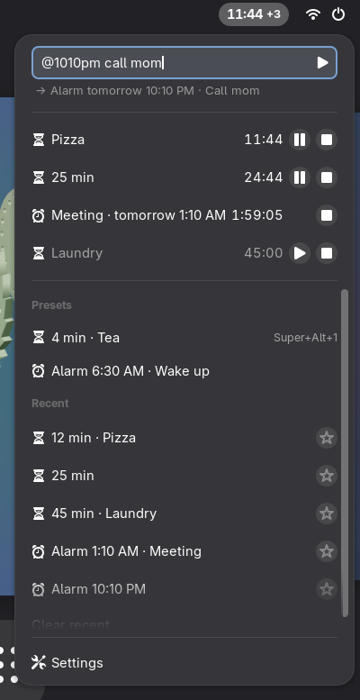
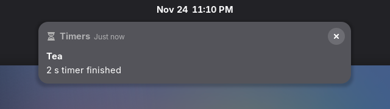
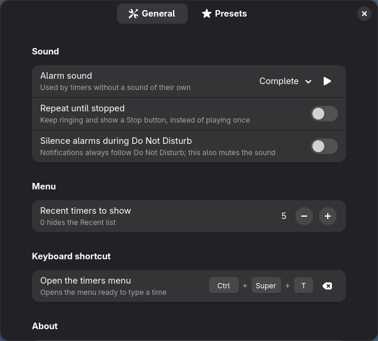

# Timers

Multiple countdown timers and clock-time alarms in the GNOME top panel.
Type a time, press Enter, and get on with your day.

<p>
  
  
</p>

Supports GNOME Shell 46–51.

## Features

- **Several timers at once**, each with an optional name: `12m pizza`
- **Type it the way you say it**: `5 min`, `2 hours`, `1.5h`, `in 10 min tea`
- **Alarms at a clock time**: `@14:30`, `7 am`, `5:30 pm`, `@1010pm`, `@noon`
- **Presets**: saved timers started with one click or their own keyboard
  shortcut, each with its own sound
- **Recent** timers, started again with one click
- **Sounds**: Bell, Complete, Message, or your own sound file
- **Quiet by default**: a finished timer plays its sound once, shows a short
  notification and clears itself. Optionally it keeps ringing until stopped.
- Follows **Do Not Disturb**, the 12/24-hour clock setting and **time zone**
  changes
- Keeps counting on the **lock screen** and across GNOME Shell restarts
- **Light on battery**: nothing runs while no timer does, and running timers
  wake GNOME Shell once per second however many there are

## Usage

Click the hourglass in the top panel (or press **Ctrl+Super+T**) and type a
time. A preview under the input shows how it is understood.



| You type | You get |
|---|---|
| `5m`, `90s`, `1h30m`, `5h 30m` | a countdown; units in any order |
| `5 min`, `10 minutes`, `2 hours`, `1hr30min` | the same, with unit words |
| `1.5h`, `2,5 min` | decimals: 1 h 30 min, 2 min 30 s |
| `in 5 min` | "in" is optional |
| `1:30`, `1:02:03` | minutes:seconds, or hours:minutes:seconds |
| `5`, `130`, `53000` | digits only: the last two are seconds → 0:05, 1:30, 5:30:00 |
| `12m pizza` | a countdown named "Pizza" |
| `@14:30`, `at 14:30`, `@1010pm`, `@noon` | an alarm at that time (tomorrow if it has passed) |
| `5pm`, `5:30 pm`, `7 am` | an alarm; with am/pm the `@` is not needed |
| `@14:30 meeting` | an alarm named "Meeting" |

Digits from other scripts work too (for example Bengali `৫m`). Without am/pm,
a colon time such as `14:30` is a countdown, so use `@14:30` for an alarm.

Each timer in the menu can be paused, resumed or stopped. The panel shows
the timer that ends soonest and how many others are running.

When a timer finishes:



### Preferences



- **Alarm sound**, with a preview, for timers without their own sound
- **Repeat until stopped**: keep ringing and show a Stop button
- **Silence alarms during Do Not Disturb**
- **Recent timers to show** (0 hides the list)
- **Keyboard shortcut** to open the menu
- **Presets** page: add, edit, reorder and delete presets, each with a time,
  name, sound and shortcut. A recent timer can also be saved with ☆ in the menu.

## Install from source

```sh
git clone https://github.com/Asadujjaman47/gnome-timers.git
cd gnome-timers
make install
make enable
```

A first install loads immediately. After updating to a newer version, log out
and back in: GNOME Shell caches extension code, so a re-installed extension
only reloads with a new session.

## Development

Requirements: `gjs`, `glib-compile-schemas`, `gnome-extensions`, Node.js (for ESLint).

```sh
npm ci            # install ESLint
make check        # lint + unit tests + schema check (same as CI)
make test         # unit tests only; `gjs -m tests/run.js parser` filters by file
make pack         # build build/timers@asadujjaman47.github.io.shell-extension.zip
make run          # start a nested GNOME Shell with the extension (own settings)
make screenshots  # headless screenshots in several styles, plus lock-screen checks
make qa           # headless storage, memory-leak and power checks (~9 min)
make pot          # regenerate the translation template
```

`make run` starts a separate GNOME Shell in a window, which picks up code
changes without logging out. It has its own settings in `build/run/`, so it
never touches your real session; delete that folder for a fresh start. When
its window is closed, anything left over from that session is stopped.
It uses `gnome-shell --devkit` on GNOME 49+ (install `mutter-devkit`, e.g.
`sudo dnf install mutter-devkit`) and `--nested` on older versions.

`make screenshots` runs a headless GNOME Shell with a small development-only
helper extension (`tools/screenshots/driver/`) that drives the menu in the
dark, light, high-contrast and large-text styles and saves screenshots to
`build/screenshots/`.

`make qa` uses the same helper to type inputs into the real menu and check
what is saved and restored after a restart, to run hundreds of rounds of use
and check that every row, timer and notification is freed and memory stops
growing, and to measure CPU time and wakeups per second. Results are in
`build/qa/driver.log`; `TIMERS_QA_PARTS=storage,memory,power` picks parts.

`tools/compat/run.sh <target>` runs the same checks against another GNOME
Shell version in a podman container (output in `build/compat/<target>/`; no
GPU needed):

| Target | GNOME Shell |
|---|---|
| `ubuntu-24.04` | 46 |
| `debian-13` | 48 |
| `fedora-43` | 49 |
| `fedora-44` | 50 |

Each image is about 1 GB; remove it afterwards with
`podman rmi localhost/timers-compat:<target>`.

Logs from the running extension:

```sh
journalctl -f -o cat /usr/bin/gnome-shell
```

### Code layout

| Path | Contents |
|---|---|
| `src/core/` | Pure JavaScript logic (no GNOME imports), unit-tested |
| `src/services/` | GNOME integrations: settings, sound, notifications, shortcuts |
| `src/ui/` | Panel button and menu (GNOME Shell widgets) |
| `src/prefs/` | Preferences window pages (GTK 4 / libadwaita) |
| `tests/` | GJS test runner, unit tests and a fuzz test for the input parser |
| `tools/` | Development scripts: nested session, screenshots and QA, other GNOME versions, fallback sound |

ESLint enforces the layering: `src/core` cannot import `gi://` or
`resource://` modules, preferences code cannot import GNOME Shell modules, and
Shell code cannot import GTK. It also enforces GNOME Shell's code style.

`sounds/fallback.oga` is generated by `tools/make-fallback-sound.sh`. The
built-in sounds come from the freedesktop sound theme installed on the system.

## Translations

The template is `po/timers.pot` (`make pot` regenerates it). To add a
language, copy it to `po/<language>.po` (for example `po/bn.po`) and translate
it; `make pack` compiles the translations into the extension.

## License

[MIT](LICENSE)
